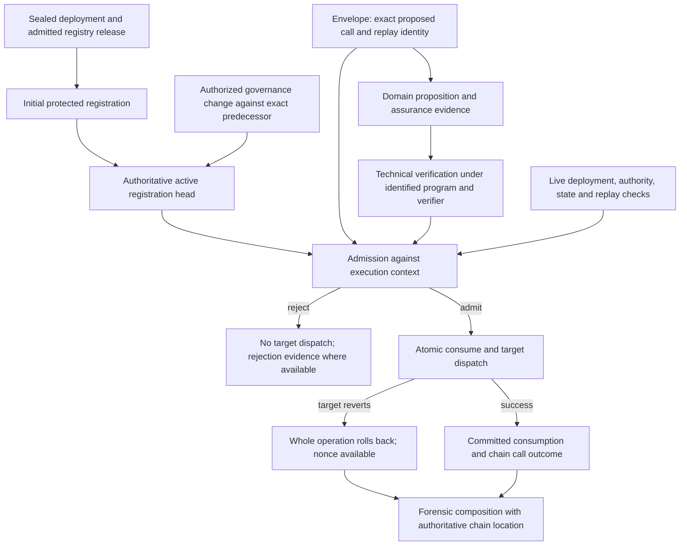

# Assured Operations V1: operation intent and protected registration

Status: **architecture specification; specified/unregistered for production**.
An isolated [treasury enforcement prototype](../../examples/assured-operations/README.md)
exercises a narrow dispatcher profile; it is not production artifact adoption.
The proposed schemas and domain strings below have not been added to the hash
intent registry. This document does not claim deployment readiness or change an
existing artifact's preimage. Runtime adoption requires closed-shape validators,
registered domains/intents, golden vectors, and conformance for the chosen adapter.

## Decision and scope

An `AssuredOperationEnvelope.v1` identifies a proposed operation **before assurance
generation**. It is a small intent. A separate `ProtectedOperationRegistration.v1`
selects the concrete assurance policy for that deployment instance and entry route.
Existing domain-specific propositions, evidence, verification records, observations,
and authority artifacts supply assurance. Admission is a derived relation among
these inputs and the authoritative execution context, rather than an assertion
inside the envelope.

The registration active immediately before dispatch selects the policy. That
policy specifies which configuration versions, assurance generation contexts,
authority contexts, and observations it accepts. This is model C from the temporal
question: A (generation configuration) and B (execution configuration) are explicit
policy choices within it. The default is B. Generation time alone confers no
continuing authority. Registration currentness, deployment currentness, replay,
and required live-state checks always happen at execution.

Recommend a hybrid with an immutable declaration that a route remains protected,
plus a governed policy selection and a reversible disabled state. Pure immutable
registrations are a supported smaller profile. Removal requires an explicitly
removable deployment profile established at inception; the recommended hybrid
forbids it. There is no generic ordering of opaque policies by "strictness."

V1 is an EVM external-call grammar. Applications supply their proposition,
argument interpretation, state projection, authority mechanism, and policy.
Pro-rata is a standalone application primitive and a reference consumer of this
grammar. No generic field depends on pro-rata, Sew, escrow, or financial concepts.

Non-goals: Solidity or engine implementation, an L2 design, EEZ runtime integration,
proof-system selection, governance timing design, new research/reward machinery,
automatic detection of semantically equivalent state transitions, and a universal
policy, verifier-configuration, authority, observation, or receipt root.

These non-goals describe the architecture task. The subsequent isolated prototype
implements only ordinary Solidity dispatch and an application test policy; it
retains the execution-engine and cross-domain non-goals.

## Existing-artifact audit and reuse boundary

The inspected contracts, rather than similarly named artifacts, determine reuse.

| Existing contract | Exact useful proposition | Reuse / limitation |
|---|---|---|
| [Canonical hashing](../specs/evidence/CANONICAL_HASH_SPEC_V1.md), [encoder and schemes](../../src/resolver_sim/hash/canonical.clj) | Typed canonical bytes and domain-separated SHA-256; `canonical-hash-scheme.v1` is permanently SHA-256 | Use unchanged. Schema versions or helpers named v2 are not another registered hash scheme. |
| [Genesis](../../src/resolver_sim/genesis.clj) | `chain-instance-genesis.v1` identifies the initial execution/authority/configuration domain | Use only as execution-instance identity; later state, releases, and deployments remain separate. |
| [Registry admission](REGISTRY_ADMISSION_V1.md), [implementation](../../src/resolver_sim/registry/admission.clj) | Candidate may occupy binding and scope under immutable policy; release selects admitted bindings | Reuse candidate, manifest, evaluation, scope, release. Release selection does not prove present deployed state. The current focused `verify-candidate` checks root, manifest reference, and chain agreement; it is not a complete runtime/proxy/source-authentication check. |
| [Registry observation](../../src/resolver_sim/registry/observation.clj) | Release-selected candidate and projection result at an exact block | Reuse for observations whose scope fits. Local validation recomputes roots; it alone does not authenticate RPC results or establish finality. |
| [Configuration head](../../src/resolver_sim/configuration_head.clj), [transaction boundary](../../src/resolver_sim/transaction/protocol.clj) and [ordering](../../src/resolver_sim/transaction/ordering.clj) | Authorized head installation against an exact predecessor, atomic ordering, and expected/observed state | Reuse the fence/CAS and ordering semantics. An EVM adapter needs authoritative chain ordering, not a second off-chain store claiming authority. |
| [Governed authority consumer](../../src/resolver_sim/assurance/governed_authority_consumer.clj), [configuration authorization](../../src/resolver_sim/benchmark/configuration_transition_authorization.clj) | Evaluate authority under retained current material; bind a change to its predecessor and proposed content | Reuse where the authority domain matches. These are not universal EVM ownership or governance definitions. |
| [Proof admission](../../src/resolver_sim/allocation/proof_admission.clj) | Application proof identity binds statement, ELF, VKey, public values, proof bytes, and verifier evidence | Preserve the distinction between artifact, cryptographic verification, and admission. Reuse that profile only for its application; a caller's `verified?` flag is insufficient. |
| [Execution attempt/receipt](../../src/resolver_sim/benchmark/execution_attempt_receipt.clj) | Command led to an observed attempt, status, and output | Compose for this execution-command domain; does not establish EVM call inclusion, admission, or financial movement. |
| [Observed Anvil execution](../../src/resolver_sim/research/anvil_executor.clj), [observed assurance](../../src/resolver_sim/research/observed_assurance.clj) | Declared/observed research environment, executed action, before/after state, result, fixed validation | Research execution evidence, not arbitrary production-chain authorization. Transaction hash is deliberately excluded from its semantic receipt root. |
| [Governed result receipt](../../src/resolver_sim/benchmark/governed_authority_result_receipt.clj), [procedure witness](../../src/resolver_sim/assurance/procedure_execution_witness.clj), [execution observation](../../src/resolver_sim/execution/observation.clj) | Authority finalization lineage; witnessed procedure; claimant runtime completion | Their scopes do not establish a general protected EVM operation. Reuse a matching constituent; do not rename them as generic receipts. |
| [Quantity identities](../../src/resolver_sim/pro_rata/quantity.clj), [signed-delta kernel](../../src/resolver_sim/pro_rata/canonical_effects.clj), [portable transitions](../../pro_rata_contract_src/resolver_sim/pro_rata_contract/contract.clj) | Scoped quantity identity and deterministic before + deltas = after | The quantity/delta/transition kernel is protocol-neutral despite namespace placement. Reuse the kernel, not the pro-rata allocation compiler. Arithmetic consistency does not prove chain events occurred. |
| [ERC-20 asset](../../src/resolver_sim/shortfall/evm_asset.clj) | Token contract, chain ID, base units | Reusable computational identity despite namespace placement; additionally bind the execution chain instance. Its existing uint64 chain-ID range is narrower than genesis's uint256 range. It does not assert token authenticity. |
| [Forensic evidence graph](../../src/resolver_sim/evidence/forensic_graph.clj) | Typed declared/observed/derived/validated subjects, causal links, and explicit evidence gaps | Compose existing evidence nodes; do not introduce a second persisted graph. |

The [canonical-artifact inventory](canonical-artifacts/README.md) is proposed, not
a runtime registry. It also records that `realized-allocation-execution.v1` has no
separate canonical execution root: no such root is invented here.

Genuine prerequisite gaps: an adopted EVM enforcement/target-resolution profile;
an application's concrete assurance policy and public-value contract; chain-backed
registration activation/currentness evidence; and an authenticated per-call chain
observation adapter. None is solved by an aggregate hash. Existing artifacts can
compose their facts, but their existing validators do not establish all these joins.

## Composition and lifecycle



Evidence exists → technical verification → policy admission → execution authorization
are four distinct propositions. A technical verification record can outlive the
configuration that admitted it. Admission must be re-evaluated at execution; an
off-chain admission report is advisory until the atomic boundary authenticates its
inputs. Successful admission does not imply successful target execution.

## Canonical field grammar

`Ref` is a closed nested value `{:artifact/type T :artifact/root H}`. `T` is the
exact string or keyword discriminator of an existing versioned artifact; those
types remain distinct. `H` is `sha256:<64 lowercase hex>`. An existing artifact
whose API emits raw 64-character SHA-256 hex is referred to using the lossless
`sha256:` prefix, without changing its body, root algorithm, or discriminator.
Non-SHA-256 domain references require their own explicitly adopted profile; v1
does not reinterpret them as SHA-256. References must resolve, recompute, and be
type-checked. Unknown or missing material fails closed for authorization.

All table fields are present, including nullable fields. All maps are closed;
unknown keys fail. `U256` is an integer in `[0, 2^256)`, with no float, string, or
decimal conversion. Address is lowercase `0x` + 40 hex digits and nonzero, following
genesis. `CodeHash` is `keccak256:` + 64 lowercase hex digits of actual EVM runtime
bytes. EVM code hashing is separate from canonical artifact SHA-256 hashing.

### `AssuredOperationEnvelope.v1`

Stored self-root key: `:assured-operation-envelope/root`, excluded from the body.

| Body field | Type | Required semantic binding |
|---|---|---|
| `:artifact/schema` | Exact string `AssuredOperationEnvelope.v1` | Select this closed grammar. |
| `:chain-instance/root` | SHA-256 reference | Root of `chain-instance-genesis.v1`; wrong-instance reuse fails even for identical chain IDs. |
| `:deployment` | Selection map below | Exact admitted candidate, release, binding and scope; prevents candidate/release substitutions. |
| `:target/address` | Address | Actual call recipient on this execution instance. |
| `:target/code-bindings` | Nonempty vector below | Exact dispatch/runtime closure; proxy bytecode alone is insufficient. |
| `:execution/profile-ref` | Ref | Admitted adapter contract: enforcing instance, caller mapping, target resolution, replay namespace and cross-domain mode. Its identity must include an exact enforcement instance or a shared consumption domain, never just an implementation class. |
| `:operation` | Route map below | Exact external route; optional application operation definition is an additional binding. |
| `:calldata/hash` | SHA-256 reference | SHA-256 of exact raw target calldata bytes, not decoded arguments, text hex, or dispatcher wrapper calldata. |
| `:native/value` | U256 | Value actually forwarded to the target, in native base units; extra/refunded wrapper value is governed separately by the profile. |
| `:caller` | Caller map below | Explicit principal-bound or bearer intent. |
| `:replay` | Replay map below | One-shot operation identity within a persistent consumption domain. |
| `:validity` | Validity map below | Optional execution bounds; never substitute for current registration or state validation. |
| `:domain-context-ref` | Ref or nil | Additional origin/destination/settlement facts only when cross-domain interpretation requires them. |

Exact nested shapes:

* `:deployment`: `{:release-ref Ref :candidate-ref Ref :binding-id K :scope-root H}`,
  where `K` is the binding ID's exact keyword/string type and `H` is SHA-256. The
  release is specifically the existing protocol-registry release, not a software
  release. Resolve its candidate to the sealed manifest, artifact/source identities,
  address, chain, and runtime facts. Any separate software release identity remains
  in that deployment provenance or an application's proposition, not a conflated root.
* Each code binding: `{:role K :address Address :runtime-code-hash CodeHash
  :deployment-ref Ref}`. `K` is a qualified keyword defined by the execution
  profile. Include the target and all profile-required implementation/beacon/facet
  identities. Sort by canonical bytes of `[role address]`; reject duplicate pairs.
  Each referenced deployment must resolve to that address/code on this instance.
* `:operation`: `{:route :selector|:fallback|:receive :selector S :definition-ref R}`.
  `S` is exactly lowercase `0x` + 8 hex digits for selector routes, otherwise nil;
  `R` is Ref or nil. Selector requires calldata length ≥ 4 with matching prefix.
  Receive requires empty calldata and an admitted receive route. Fallback requires
  the deployment profile's exact fallback dispatch rules; empty calldata can be
  fallback when receive is absent. There is no catch-all selector placeholder.
* `:caller`: `{:mode :principal|:bearer :principal A :authority-ref R}`. Principal
  requires Address `A`; bearer requires nil. `R` is Ref or nil. An authority artifact
  identifies the authority context, not proof that a submitter is authorized.
  Authentication evidence is supplied separately and checked against this intent.
  Policy may forbid bearer mode or require a concrete authority reference.
* `:replay`: `{:namespace-ref Ref :nonce N}` with U256 `N`. This namespace is
  authenticated by the execution profile, not selected freely by the submitter.
* `:validity`: `{:not-before-block B :not-after-block E}` with each nil or U256.
  Bounds are inclusive execution-chain block numbers; when both exist, `B ≤ E`.
  nil means no envelope bound. Policy can require a narrower bound. Generation
  time or a block number without its authenticated context is not freshness proof.

The calldata bytes and all referenced artifacts must be available to reconstruct
the operation. ABI decoding uses the admitted target/release/profile definition;
re-encoding must equal the committed bytes. Different accepted calldata encodings
have different intent roots. Never discard trailing bytes during hashing.

Policy, assurance, program/VKey, configuration, and live observation selection are
outside this intent. Consequently a policy change can alter admission of the same
intent without changing what call was proposed. A caller needing to pin additional
generation context must require it through the concrete proposition/authentication
profile. Envelope caller authentication must approve either that exact admission
context or an explicit delegation to the current protected policy; possession of
calldata or a bearer proof alone does not authenticate a principal.

### `ProtectedOperationRegistration.v1`

This is an immutable desired registration revision. It becomes authoritative only
through authenticated initial deployment or a committed activation. Self-hashing a
revision does not activate it. Self-root key: `:protected-operation-registration/root`.

| Body field | Type | Meaning |
|---|---|---|
| `:artifact/schema` | Exact string `ProtectedOperationRegistration.v1` | Closed revision grammar. |
| `:chain-instance/root` | SHA-256 | Exact execution instance. |
| `:deployment-ref` | Ref | Exact registry candidate for this deployment instance; candidate chain ID must agree with genesis. |
| `:target/address` | Address | Instance, not an implementation class. |
| `:execution/profile-ref` | Ref | Defines the authorized enforcement and registration store, runtime resolution, and immutable floors. |
| `:operation` | Same route map as envelope | Registration key includes route and optional exact operation-definition identity. |
| `:revision` | U256 | Initial 0; successor is predecessor + 1; no wraparound. |
| `:parent-ref` | Ref or nil | nil only for initial revision; exact predecessor otherwise. |
| `:status` | `:protected|:disabled|:unprotected` | Protected requires assurance; disabled refuses dispatch; unprotected is possible only under an inception profile allowing removal. |
| `:assurance-policy-ref` | Ref or nil | Existing or application-defined concrete versioned policy; non-nil for protected and disabled, nil only for unprotected. No umbrella `policyRoot`. |
| `:control-ref` | Ref | Immutable deployment-established controls: mutation mode, authority lane, floors, activation delay, and removal permission. |

Authorization evidence is an external activation input, not a revision-body field:
it must bind the proposed registration root and exact predecessor. Including its
own reference inside the registration would create a hash cycle when authorization
commits that registration. Activation observations/ordering evidence retain the
authorization reference and the installed revision; initial deployment supplies
its separate inception authorization/provenance.

The existing initial sealed deployment may not have a field for registration roots.
Do not silently add one or change its hash. An inception attestation/control profile
must authenticate the initial registration set alongside the existing deployment
identity; extending a deployment schema is a separate versioned prerequisite.
Upgrades retaining the same proxy instance retain its registration history and
consumption state. A newly admitted deployment candidate requires an explicit
authorized migration join from the previous history, or a fresh instance policy.

## Root construction

For exactly the validated body in either table:

```text
envelope root = "sha256:" + lowerhex(SHA256(
    UTF8("prf.assured-operation-envelope.v1") || canonical-bytes(envelope body)))
registration root = "sha256:" + lowerhex(SHA256(
    UTF8("prf.protected-operation-registration.v1") || canonical-bytes(registration body)))
calldata/hash = "sha256:" + lowerhex(SHA256(raw target calldata bytes))
```

The first two are typed canonical artifact hashes under `canonical-hash-scheme.v1`.
The last is a raw-byte commitment, not an additional artifact scheme. The two
proposed domain strings must pass the existing prefix-free domain registry check
before adoption. There is no new length frame, concatenation ABI, or aggregate root.

Maps use the existing encoder's canonical key-byte ordering, independent of table
order or EDN insertion order. Vector order is semantic; only the code-binding
vector has the sorting rule stated above. Supported values are nil, boolean,
integer, string, keyword, vector, and map. These artifacts use that algebra with
the narrower field constraints above; unsupported host objects, sets, records,
symbols, lists, ratios, floating numbers, and BigDecimal fail. No implicit
case-folding, Unicode normalization, decimal-to-base-unit conversion, or omitted
optional fields. Hash after validation, not permissive projection.

Only the exact named self-root is excluded. Optional nil differs from missing
(missing is invalid). Referenced roots are committed as typed reference values;
the referenced bodies keep their own canonical rules. Output/persisted metadata
does not enter these closed bodies. A version change needs a new schema and domain;
existing v1 roots never acquire new fields or altered normalization. Hash collision
resistance does not establish provenance, source truth, admission, or currentness.

## Registration models and activation state machine

| Concern | A: immutable | B: governed/removable | C: hybrid permanent protection |
|---|---|---|---|
| Security / compromised governance | Cannot alter policy; obsolete policy can remain unsafe | Governance can remove gates; maximum authority risk | Governance can disable/change policy but cannot remove immutable protection; compromised policy authority can still weaken policy within floors |
| Upgrades and recovery | New instance or predeclared compatible upgrades; weakest recovery | Flexible policy/runtime migration and recovery | Policy/runtime migration within inception controls; disabled state handles emergencies |
| Bypass risk | Routes still require application closure | Removal and new aliases increase risk | No removal; new aliases still need closure review |
| Ergonomics | Smallest control plane; policy maintenance costly | Familiar administration; larger audit surface | Explicit controls plus policy updates; moderate complexity |
| Forensics | Initial attestation plus execution observations | Every predecessor, authorization, schedule, activation required | Same lineage plus immutable floor checks |
| Immutable / upgradeable deployments | Natural / restrictive | Compatible with both if control authority exists | Compatible with both; upgrade route closure must be re-admitted |
| Engine enforcement | Straightforward registered gate | Engine must respect governed history | Engine must enforce permanent floor and current head |

The authoritative key is `(chain-instance, deployment instance, target, execution
profile, route, operation definition)`. The profile prevents competing stores or
two simultaneous heads for the same enforceable route. Application operation IDs
cannot create separate entries that bypass a selector's mandatory gate: the
deployment's route-to-definition mapping is unique and authenticated.

```text
unregistered --authenticated inception/add--> protected
protected    --authorized policy update-----> protected (next revision)
protected    --authorized disable-----------> disabled  (next revision)
disabled     --authorized enable------------> protected (next revision)
protected/disabled --authorized remove------> unprotected (removable profile only)
unprotected  --authorized add---------------> protected (next revision)
```

Unregistered is absence, not an authoritative claim that a route is harmless.
Each deployment profile declares its default: allow unprotected routes with
declared closure limits, or deny unknown routes. The recommended consequential
deployment profile denies unknown state-changing routes. A tombstone for removal
remains in history; deletion is never removal. Pure immutable controls forbid all
successor policy/protection changes; an emergency disable lane exists only if
declared at inception.

An update proposal names the exact predecessor registration, proposed revision
root, and existing authority context. Schedule and activation follow the concrete
control artifact's delay and authority rules. Activation authenticates current
predecessor, authorization currentness, timing and immutable floors, then atomically
replaces the head. Stale or competing proposals fail; they do not inherit
authorization for a different predecessor. Reuse transaction ordering/fences where
appropriate. An EVM deployment authenticates activation through its chain-backed
control path and observations; a hash-linked file history alone is insufficient.

Only declaratively defined constraints may be called monotonic tightening, such
as enabling disabled state or narrowing an explicit allowed configuration list.
Replacing arbitrary policy roots has no inferable strictness relation; it takes
the full declared policy-change lane. Loosening/removal delays are a property of
that concrete control artifact. This specification does not choose universal delays.

Adding protection immediately before execution applies immediately when activation
is effective. Changing policy invalidates earlier admission unless the new policy
explicitly accepts the old assurance/configuration. A temporary removal and later
restoration are visible revisions and cannot defeat a permanent floor. Pausing,
policy changes, and implementation upgrades cannot reset the replay namespace.

## Policy, assurance, configuration, and temporal admission

The concrete policy defines required proposition roles, their composition rule,
accepted technical-verification profiles, authority/currentness constraints,
configuration selection, state checks, and reuse bounds. These obligations belong
to its existing versioned schema or an application-owned schema with its own
canonical definition. This is an adapter contract, not a new generic policy artifact.
Multiple required components are supported from the outset; admission cannot omit
one or combine individually valid components whose joined inputs disagree.

A submission is a transport view containing envelope and calldata, role-labelled
proposition/evidence refs, verification refs, generation-context refs, and required
authority/state witnesses. It has no canonical "everything root." A derived
admission view records their exact references and decisions, the active registration
revision, current execution configuration/head, accepted verification configuration,
and chain location. Existing domain records and forensic nodes persist these facts
where their schemas fit; missing joins are recorded as adapter gaps.

For an envelope-specific proof, its authenticated statement/public values commit
the envelope root and every policy-required generation input. For reusable assurance,
the statement instead commits a bounded predicate/domain (for example a specified
range of operations, amounts, destinations, instance and revision). Admission
authenticates that the exact envelope satisfies that predicate. Attaching a proof
to an unrelated envelope or hashing both in a submission is never binding evidence.

Use the smallest verifier identities required by that concrete proof profile:
existing verifier ID/entry and adapter deployment, exact registry root, program ID,
ELF hash, VKey, statement/public-values schema, decoder identity and proof bytes
commitment. Authenticate entry membership and program/configuration joins. Where
relevant reuse `chain-configuration.v1`–`.v4`, verifier-registry canonical roots,
and their activation/head evidence. Their version-specific preimages stay unchanged.
The registry's existing packed entry/registry hashing is not replaced by this
document's typed-map root construction. No `verifierConfigurationRoot` is introduced.

| Selection rule in the active concrete policy | Behavior after configuration changes |
|---|---|
| Current at execution (default) | Accept only the configuration/entry active at the execution boundary. Old evidence needs compatible re-verification/re-admission. |
| Explicit pinned configuration | Policy names exact accepted config/registry/program identities and authenticates the generation context. Execution still checks registration and current revocation rules. |
| Explicit historical allow-list | Policy names accepted roots/epochs and compatibility/reuse windows; membership, not an old `active` flag, determines acceptability. |

An epoch alone is insufficient: bind chain instance, configuration root and
authenticated head/activation lineage. Every policy must define revocation handling
for previously accepted verifiers and authority credentials. V1 default: current
revocation vetoes historical acceptance. A profile that permits historical authority
after revocation must declare that consequence and its bounds explicitly.

At `t0` construct intent; at `t1` produce assurance under C0; at `t2` activate C1
and/or registration R1; at `t3` derive admission under the registration then active.
C0 evidence passes only if R1's policy accepts C0 and all remaining live checks
pass. Evidence generated under R0 cannot force R0 to remain effective. A state
observation is similarly evaluated under the executing policy's freshness rule.
Record generation context, accepted verification context, and execution context
separately even when all three coincide.

An execution admission fence must bind the exact registration head, target/runtime
closure, selected policy, configuration, authority and state predicates. No mutable
read followed by an external call to an untrusted verifier may silently reuse a
stale fence. Re-evaluate after callbacks or prohibit mutating callbacks; serialize
protected dispatch and registration/configuration mutation for the whole operation.
The target may perform authorized post-state changes, but cannot retroactively
change the policy under which this dispatch was admitted.

Execution must name the exact expected registration root **and revision**, compare
them to the active head at entry, and retain that observed tuple in admission/call
evidence. Within a transaction, an activation affects later calls; within a block,
transaction order determines when activation takes effect. Earlier dispatch retains
its pre-activation tuple. A stale expected tuple rejects rather than silently
switching policy. An uncaught enclosing revert rolls back both activation and
execution; a caught execution revert need not roll back an earlier activation.
Serialize activation and dispatch so callbacks cannot change the consumed tuple.

The consumed state evidence must similarly retain its exact domain-specific
projection/observation references and execution location. Equal projection results
at different call locations are not automatically the same observed execution.

The normative protected-dispatch decision is the conjunction below, evaluated
against one authenticated execution boundary. Predicates are obligations for the
concrete profile, not semantic macros or an implementation API:

```text
Authorize(E, context, components) iff
  ValidCanonicalEnvelope(E) and ActualCallEqualsIntent(E, context)
  and AdmittedDeploymentSelection(E.deployment, context)
  and LiveRuntimeClosureEquals(E.target, context)
  and ActiveRegistration(E.instance, E.target, E.profile, E.operation) = R
  and R.status = protected and AuthenticatedCurrentHead(R, context)
  and P = ResolveAndValidate(R.assurance-policy-ref)
  and ValidityBoundsHold(E, context)
  and PrincipalOrBearerAllowedAndAuthenticated(E.caller, P, context)
  and EveryRequiredComponentHasAuthenticatedPropositionBinding(components, E, P)
  and TechnicalVerificationSatisfied(components, P)
  and SelectedConfigurationsAndRevocationsAllowed(components, P, context)
  and RequiredStateChecksHold(components, P, context)
  and ReplayNamespaceAuthorizedAndUnused(E.replay, E.profile, P, context)
  and RequiredNullifiersUnused(components, P, context)
```

Admitted deployment selection must resolve the exact release/binding/scope/candidate
and all necessary manifests and evaluations. The current policy/profile states
whether historical registry releases remain acceptable; existence in an old release
alone cannot override a deployment revocation. Disabled routes always reject.
Unprotected routes follow only their explicit removable/default-route profile and
make no assured-execution claim. The atomic fence must remain valid through target
dispatch and consumption; no predicate result is an independently reusable permit.

## Route and enforcement boundary

Selector alone is not operation identity. V1 protects the exact target instance,
route, expected runtime closure and optional canonical operation definition. An
application ID has meaning only through an authenticated mapping to actual calldata
and a closed dispatch route. Registration matches actual dispatch, not a supplied
friendly operation label.

* Direct contracts: canonical deployment profile inventories all externally callable
  state-changing paths and authenticates their guarded closure. An alias that reaches
  the same consequential mutation must use the same gate or be disabled.
* Proxies/delegatecall: bind proxy runtime, resolved implementation and any relevant
  beacon/facet routing state; verify resolution at dispatch. Preserve the proxy's
  state instance. Arbitrary delegatecall or unknown runtime resolution is unsupported
  by a conforming v1 profile; it fails closed rather than claiming target-code safety.
* Fallback/receive: register explicit routes; calldata length and actual resolution
  matter. Upgrade-introduced routes require new closure admission.
* Batching/multicall: decompose into separately admitted envelopes, or use a concrete
  batch proposition that binds exact ordered subcalls, values and per-route gates.
  An outer selector does not grant authority to hidden inner protected calls. V1
  supplies no generic atomic batch artifact.
* Contract-to-contract calls: preserve the profile-defined principal and immediate
  caller separately. Normal `CALL` makes a dispatcher the target's `msg.sender`;
  legacy contracts cannot pretend they received a direct principal call. A profile
  must define supported forwarding and target authentication. Never use `tx.origin`.
* Internal calls: external selector coverage cannot prove every semantic state change
  is protected. Shared internal mutators, helpers and reentrant paths need application
  closure. Nested consequential calls need distinct gates; a parent authorization
  does not implicitly authorize all descendants.

## State binding and freshness

State binding is a capability of the concrete assurance policy, not a mandatory
envelope field. Required state references are authenticated inputs to the proposition
and admission. Reuse typed observations/projection definitions and result roots.
There is no additional universal `snapshotRoot` or `observationRoot`.

| State profile | What admission must establish |
|---|---|
| None | Policy explicitly needs no mutable state premise. Registration, code, caller and replay checks still apply. |
| Block-pinned fact | Authenticate block hash and number, projection definition, instance and candidate. Check ancestry/finality/age under the policy. This alone proves no current-state equality. |
| Current projection equality | Recompute the same authenticated projection immediately before dispatch and compare its result to the proof-bound result. Include every dependency affecting the proposition. |
| Revision/CAS | Compare an authenticated application revision or state commitment to the proof-bound expected value and update it atomically with execution. Revision cannot reset or wrap. |
| Storage/state witness | Authenticate account/storage proofs under the anchored block state root; additionally supply a currentness mechanism when the policy requires live equality. |

Projection equality allows a change-away-and-back if the semantic projection is
again equal. A policy requiring rejection after *any* intervening change uses a
monotonic revision/CAS profile. An observer-selected projection is insufficient;
the policy determines the definition and relevant accounts/storage/runtime inputs.
External sources require an authenticated observation/finality path. A hash of an
untrusted RPC response does not establish state truth.

Perform the check and dispatch in one serialized operation with no unguarded callback
gap. Policies depending on intra-call state require a check at the protected mutation
point or a target revision lock; a dispatcher precheck alone cannot stop subsequent
reentrant mutations. Freshness refers to the declared projection, not all chain state.

## Replay, consumption, and failure

Every v1 envelope is one-shot. Assurance can be one-shot or reusable without making
the operation itself reusable. For another operation construct another envelope with
a new nonce; reusable assurance must authenticate a predicate admitting both intents.

The consumed key is `(chain-instance/root, execution-profile consumption domain,
authenticated replay namespace, nonce)`. Namespace ownership/scoping (principal,
target, operation, or application revision) is fixed by the admitted profile and
concrete policy. Profile/registration updates must retain the same consumption ledger
or provide an authenticated migration. Independent dispatcher instances cannot
authorize the same envelope unless they share that ledger. Consumed-envelope-root
indexing is a useful audit index but does not replace namespace/nonce enforcement.

Before target dispatch mark the nonce reserved/consumed so reentrant attempts fail.
Consumption and target effects commit atomically. A target revert rolls back the
entire operation, including reservation; retry of that intent is permitted. V1 does
not catch failure and permanently burn the nonce. A successful no-op still consumes
the nonce. Authorization rejection performs no target call or consumption. Expiry
does not make a successful nonce reusable.

If a proof/nullifier carries a one-use entitlement independent of envelope nonce,
its concrete policy requires a second atomic nullifier ledger with defined scope.
Reusing the same statement with a different nonce then fails. Nullifier scope must
not change with a policy upgrade. No generic nullifier hash is invented here.

## Receipt investigation: reconstruct the proposition by composition

The result proposition is: **At an exact execution location on instance I, intent E
was rejected or was admitted under registration R/policy P using assurance A and
identified verification/configuration inputs; a particular target call occurred,
with an authenticated outcome and any linked resulting state/effects.**

Existing receipts cover parts of this proposition but none inspected covers all
its EVM joins. The decision is to specify a **derived forensic composition view**,
using existing typed evidence nodes and applicable observations/receipts. Do not
introduce `CanonicalOperationReceipt.v1` or a new receipt domain/root in this task.
If a production consumer later needs a single independently rooted wire artifact,
justify only the missing admission-to-call join and avoid copying constituent data.

| Reconstruction input | Authoritative role |
|---|---|
| Envelope root, available body and target calldata | Intended call, instance, deployment/release, principal, value and replay key. |
| Active registration and inception/activation lineage | Applicable concrete policy and why this registration was current. |
| Proposition/evidence and verification refs | Exact statement, proof/evidence bytes, technical verifier/program/VKey/decoder and accepted generation configuration. |
| Execution configuration/head and authority evidence | Why the active policy accepted those verification/authority inputs now. |
| Proof-bound pre-observation and execution-bound current checks | Relevant pre-state and satisfaction of the freshness profile. |
| Chain location | Instance plus block hash/number, transaction hash/index and exact call-frame identifier, or deterministic replay locator. EVM hashes retain their chain-native encoding. |
| Actual dispatch and outcome | Resolved target/runtime, actual calldata/value/caller, admission decision and call success/revert; derive from authenticated data, not a supplied success flag. |
| Existing transition/effects and post-observations | Resulting relevant state and effects, with derivation and same-call attribution. |

Transaction receipt status cannot identify the outcome of every internal call.
Use a profile-defined trace locator/deterministic replay, including transaction order
and pre-transaction state; RPC traces are not consensus proofs. Verify them against
chain data by re-execution or an accepted authenticated execution proof. A block-end
balance is insufficient to isolate one call's effect when other transactions or
calls affect that balance. Logs alone do not establish arbitrary token balance
semantics. An authorization-success log alone does not prove successful execution.

When an outer transaction reverts, its logs and state changes disappear. Rejected
or reverted admission may be reconstructed through authenticated transaction input
and replay; never promise a persistent on-chain failure receipt for every attempt.
An off-chain request that never entered the chain is not a chain execution event.
Existing execution-attempt records may describe it within their declared domain.

Views distinguish `authorized-and-succeeded`, `authorized-target-reverted`,
`admission-rejected`, and `unknown/not-observed`. These are derived interpretation
labels, not new persisted enum fields in an existing receipt. Missing artifact
availability, traces, or observations must be explicit forensic gaps. AO-8/AO-11
qualification requires the required materials and authenticated joins, not just roots.

## Enforcement portability

| Guarantee | Ordinary Solidity executor / guarded target | System contract or precompile | Execution environment / L2 |
|---|---|---|---|
| Exact intent, current registration/policy, technical verification, state and replay | Identical normative predicates for guarded calls | Same predicates; system implementation must be integrated into dispatch | Same predicates; native ordering/dispatch integration |
| Prevent direct target bypass | Target restricts consequential mutators to gate or embeds checks; dispatcher alone cannot do this | Calling the precompile voluntarily has the same bypass gap; mandatory dispatch hook is needed | Engine can refuse matching registered calls on every covered frame |
| Internal calls, aliases, arbitrary delegatecall | Application closure and canonical upgrade admission | Stronger only with explicit mandatory hooks/coverage | Can police specified CALL/DELEGATECALL routes and code changes; cannot infer semantic aliases automatically |
| Atomic consumption and outcomes | EVM revert/serialization and reentrancy controls | Same required atomicity | Can integrate with execution journal; must preserve specified rollback behavior |
| Reconstruction | Chain location plus observations, artifacts and authenticated replay | Same evidence obligations | Can make admission/call linkage mandatory execution evidence; retention and finality remain necessary |

The primitive is meaningful on Base or any ordinary EVM chain with a conforming
guarded target. Voluntary verification followed by an independently callable target
does not satisfy enforcement completeness. System placement by itself gives no
extra coverage. Engine hooks can remove routing bypass for registered routes and
ensure instrumentation, while alternative unregistered semantic transitions still
need application closure or a stronger admitted route coverage profile. No universal
semantic state-transition analysis is assumed. Callee-visible sender/forwarding
semantics are profile inputs; changing them changes the interpreted operation.

## Cross-domain preparation

`:chain-instance/root` always identifies execution. A single-chain operation sets
`:domain-context-ref` to nil. When needed, reference an existing/adopter-owned
domain proposition that names origin, execution, assurance source and settlement
instances, their typed roots, message identity, authenticated finality path and
replay relationship. The envelope commits that reference and the proof/policy
authenticates its joins. There is no EEZ-specific field or universal domain root.

Origin matters for transported caller authority; assurance-source domain matters
only when evidence truth depends on another chain; settlement matters when completion
is conditional on another domain. Custody/asset location belongs to the application's
proposition and state references, not mandatory core envelope fields. Do not identify
a domain by numeric chain ID alone. An EVM runtime hash is not a domain identity.

V1 executes and consumes locally; it does not claim distributed atomicity, bridge
safety or global exactly-once settlement. Cross-domain profiles must authenticate
message inclusion and bind destination intent plus source identity, and define how
reorgs and retries interact with their nullifiers. Remote finalization remains an
explicit separate proposition rather than silently upgrading local execution success.

## Conceptual validation examples

### A: independent allocation application

An application protects `ratifyAndFund(...)` on its admitted canonical deployment.
Its envelope binds target/runtime closure, exact calldata and value, principal and
one-shot nonce. Its concrete policy requires source-bound computation evidence,
current relevant state/revision, authority and the exact admitted program/configuration.
Application propositions supply the allocation and source semantics. Generic
registration and admission never inspect allocation rows or name a reserve. A stale
revision, substituted candidate, changed caller, or already consumed nonce fails.

The local conformance fixture composes the existing source-bound V2 assurance,
ratification controller, reserve and production allocator through the generic
dispatcher without changing generic artifacts or execution semantics. The
application adapter binds the prepared initiator and live reserve commitment. It
also demonstrates an unresolved consumer closure requirement: the existing public
ratification controller can still be called directly, bypassing the generic
envelope. Mandatory dispatcher enforcement therefore requires the consumer to
restrict that existing route; a dispatcher adapter alone cannot close it. The
fixture's proof verifier is a test double and does not qualify SP1 verification.

### B: treasury withdrawal with forensic financial reconstruction

An independent treasury protects `withdrawLargeAmount(token, destination, amount)`.
Use token T, source treasury S, destination D, and amount 100 base units. Assume an
ordinary token profile with no transfer fees/rebasing and isolated pre-call balances
S=1000, D=20. Native value is zero. The same envelope and registration grammar apply;
there is no withdrawal-specific core schema.

1. Decode the exact committed calldata under the admitted release's ABI and operation
   definition. Establish T, S (resolved treasury source), D and 100, execution chain
   instance, units, and all token/treasury implementation identities. Reuse
   `prf/evm-erc20-asset.v1` for T within its supported chain-ID range. Source and
   destination quantity identities use `canonical-quantity-identity.v1` with
   instance, state domain, subject, asset, kind and scope. The concrete projection
   defines authenticated subjects/locations; human labels are insufficient.
2. Resolve the registration active at execution, its concrete solvency/risk policy,
   principal authentication and any governance delegation. Reconstruct why the
   authority could submit this intent under this policy. A cryptographic proof of
   solvency is not caller authorization.
3. Resolve the assurance's proposition and accepted verification/program/configuration
   records. It must authenticate this exact withdrawal or a reusable predicate
   covering T, S, D, 100 and this instance; attach no unrelated "solvent" proof.
4. Resolve proof-bound pre-observation and current check of the required treasury
   balances, liabilities and revision. The example uses revision/CAS plus projection
   equality, so assurance generated before an intervening treasury change fails.
   Authenticate the financial pre-state at the call boundary, not merely block end.
5. Locate the actual treasury call and token transfer call on the authoritative chain.
   Reconstruct calldata, value, effective caller, execution status and token semantics
   using authenticated replay/proof. A false-returning token is not a successful
   transfer merely because the outer transaction succeeded.
6. Reuse the protocol-neutral signed-delta kernel to derive effects `S:-100, D:+100`
   and a canonical effect transition giving S=900, D=120. Independently authenticate
   post-call balance observations and join them to those quantities, effects and
   the exact call. Delta arithmetic alone does not prove these assets moved.
   Link any changed liabilities/revision through the application's state projection.
7. Compose declared intent, validated authority/admission, observed execution,
   derived effects/transition and validated post-observations using existing forensic
   evidence nodes and applicable receipt references. The result answers intended vs
   actual movement and flags discrepancies explicitly.

For fee tokens, rebasing assets, multiple destinations or supply changes, the concrete
asset/operation profile must define and observe all relevant quantities: a requested
100 may produce S:-100, D:+98 and fee-recipient:+2. Do not force equal source/destination
deltas or infer the difference is a fee without evidence. Record gas/native fees
separately from intended transferred value, and explain any uncovered quantities.
A reverted operation commits no withdrawal effects, although the sender can pay gas.
An unrelated transfer in the same block cannot be attributed to this intent.

This composition cleanly establishes the requested financial proposition using the
existing quantity, signed-delta, transition, observation and forensic graph vocabulary.
The missing production per-call observation/admission adapter is explicit; adding a
withdrawal-specific core artifact would not supply that evidence or solve the gap.

### C: governance execution / upgrade

Protect the upgrade route on an admitted proxy/control instance. Exact calldata
names the proposed implementation/configuration; the application proposition binds
its canonical artifact and software release and evaluates its required safety policy.
Use existing governed-authority evidence where its domain matches, otherwise the
application's concrete authority artifacts. Bind current proxy runtime/resolution
and pre-upgrade revision; authenticate the successor runtime and governance state
with post-observations. Existing authority transitions/receipts can be constituents,
not automatically EVM upgrade completion proofs. Replay and policy semantics are
identical to A/B; the operation moves no capital.

The local governance conformance case uses the same envelope, registration and
executor without generic changes. Its application policy binds a timelock caller,
governance approval, candidate runtime/source/release/configuration identities,
required security-policy identity and exact pre-upgrade projection. Executor and
target events compose to reconstruct the approved and installed implementation.
The fixture's deployment sealer and candidate attestations are test seams, not
production registry admission or an independent security audit. The target has a
single executor-gated upgrade route; proxy delegatecall closure remains a separate
profile requirement.

### D: stateless publication

A protected `publishDigest(bytes32)` requires a statement about a canonical document
and principal permission. Its policy selects no application state binding and allows
reuse of document assurance across distinct authorized envelopes. Each envelope
still has its own nonce and exact call, deployment and execution context. This tests
that mutable state and financial concepts are not mandatory core requirements.

### Temporal and failure counterexamples

* C0 proof, C1 active at execution: default-current policy rejects; explicit C0
  allow-list admits only if revocation, registration, caller, state and replay pass.
* R0 changes to disabled R1 before submission: dispatch fails even if C0 evidence is
  valid. R1 policy change to P1 uses P1, never the submitter's old P0 selection.
* Two submissions share nonce in one authenticated namespace: only one successful
  dispatch commits. A reverting first call permits a retry; a successful no-op does not.
* Same code/chain ID at a clone address: instance/candidate/address joins reject reuse.
* Proxy runtime unchanged but implementation changed: closure comparison fails;
  no proof against the old implementation authorizes the changed dispatch.
* Block-pinned old balances with newer live state: block validity alone is insufficient;
  a current-equality or revision policy rejects.
* A claimed withdrawal success with only a transaction status and Transfer log:
  financial reconstruction remains unqualified until call attribution and actual
  state deltas are authenticated.

## Invariants and threats

These are requirements on a conforming profile, not assertions that existing code
already implements the new primitive.

| Invariant | Required checks / qualification |
|---|---|
| AO-1 Exact target | Genesis, release/binding/scope/candidate/manifest, address and live runtime closure agree. |
| AO-2 Exact operation | Actual route, exact calldata/value, operation definition and authenticated proposition-to-intent join agree. |
| AO-3 Policy | Registration at execution selects the concrete policy; supplied policy refs cannot override it. |
| AO-4 Configuration | Program/verifier/registry/configuration identity is authenticated and acceptable under the executing policy; old authority requires explicit permission. |
| AO-5 Freshness | Policy-required projection/revision is authenticated and checked at the mutation boundary; revision profiles reject intervening changes. |
| AO-6 Replay | Atomic one-shot namespace/nonce ledger, any policy nullifier, and serialized nested calls; no reset on upgrades. |
| AO-7 Provenance | Exact deployment/release/policy/assurance references resolve and recompute; code/source/authority joins are authenticated. |
| AO-8 Reconstruction | Available artifacts plus authoritative call data reproduce each verification, admission and execution outcome; gaps are never labelled authorized. |
| AO-9 Neutrality | All application semantics live in concrete policy/proposition/projection adapters; none of the generic tables depend on an application. |
| AO-10 Portability | Identical admission, freshness, caller interpretation and atomicity predicates for the declared profile across enforcement placements; coverage differences are explicit. |
| AO-11 Financial reconstruction | For a protected withdrawal, canonical artifacts and authoritative chain data establish intended asset/amount/source/destination, authority/policy/pre-state/assurance, actual call, actual asset deltas and resulting relevant state. Requires an authenticated financial observation profile, not a new withdrawal core artifact. |

| Threat | Expected mitigation | Where guaranteed / remaining limit |
|---|---|---|
| Replay / reused assurance | Nonce ledger; explicit bounded reusable predicate; policy nullifier if one-use statement | Artifact binding plus atomic enforcement. |
| Wrong chain, target, deployment or clone | Genesis and deployment/address joins | Artifact model detects substitution; live admission authenticates provenance. |
| Wrong runtime or release | Explicit release selection and runtime closure at execution | Artifact + registration/admission; source/runtime equivalence needs admitted provenance. |
| Verifier/program/configuration substitution | Authenticate exact entry, adapter, ELF/VKey/schema/decoder and configuration selection | Technical verification + executing policy; no universal verifier root. |
| Policy/authority substitution | Active registration, predecessor-authorized updates, explicit caller authentication | Registration/current authority enforcement; governance compromise can still choose weak policy within floors. |
| Stale state / change-away-and-back | Current projection check; monotonic revision when all intervening changes matter | Concrete state profile and atomic mutation guard. |
| Selector alias / alternative entry / helper | Closed admitted route inventory and guarded consequential mutators | Application architecture; engine blocks registered routes but cannot discover semantic aliases. |
| Proxy/delegatecall bypass | Exact live runtime resolution and upgrade admission; reject unknown delegatecall | Application/profile; engine can extend mandatory frame coverage. |
| Reentrancy or mutation after precheck | Reserve nonce first; guard callbacks, serialize heads, check at mutation point | Adapter atomicity and target design; a hash is insufficient. |
| Removal immediately before execution | Permanent protection floor or explicitly governed/delayed removable profile | Registration semantics; a conforming removable profile intentionally permits authorized removal. |
| Generation before policy/configuration change | Executing policy explicitly selects current, pinned or allowed identities | Temporal admission, with current revocation default. |
| Reorg / finality | Hash-pinned observations, ancestry and profile finality; re-evaluate orphaned receipts/consumption | Chain/finality profile. Local consumption and effects both roll back on reorg; external settlement cannot assume permanence. |
| Cross-domain confusion | Typed execution instance plus authenticated domain context and message identity | Artifact/profile binding; bridge and distributed settlement protocols deferred. |
| Financial event misattribution | Per-call authenticated replay, asset semantics, pre/post projections and quantity delta joins | AO-11 observation profile; logs/block-end balances alone do not qualify. |
| Missing or unavailable bodies | Fail authorization on missing required inputs; forensic nodes mark historical availability gaps | Artifact availability and retention; commitments alone cannot reconstruct hidden data. |

## Frozen decision: execution-domain baseline (2026-10-04)

**Decision.** Keep dispatcher-mediated Solidity enforcement as the current
Assured Operations baseline. Do not begin dedicated execution-engine or L2 work
from the present evidence. Revisit only when new conformance evidence demonstrates
a recurring enforcement, duplication or bypass problem that application-level
Solidity cannot adequately address.

This freezes the direction, not production readiness. It does not qualify the
prototype sealer, proof verifier, deployment admission, or governance and proxy
controls for production. The consumer-specific gaps and their next validation
steps below remain prerequisites.

## Cross-consumer evidence and execution-domain threshold

The treasury, V2 pro-rata and governance fixtures all use the same dispatcher,
envelope and registration semantics with no generic-core changes. Their application
policies and projections remain consumer-owned. The evidence has different limits:

| Consumer | Composition | Mandatory enforcement | Production assurance/provenance |
|---|---|---|---|
| Treasury | ✓ | ✓ | Experimental |
| Governance | ✓ | ✓ | Experimental |
| Pro-rata | ✓ | ✓ | Pending |

For pro-rata, composition and mandatory enforcement refer to the route-closure
conformance result. Production assurance/provenance remains pending while the
proof verifier and deployment-provenance seams are investigated separately.

Deployment invariant: a V2 ratification controller is not operationally admitted
until its permanent execution-caller binding equals the intended deployed
dispatcher adapter, the adapter has runtime code, and its executor getter equals
the intended Assured Operations executor. The deployment check reads those values
after binding; an unbound or mismatched controller must remain fail-closed.

This route-binding invariant establishes connectivity only. Production admission
has an additional provenance requirement: every security-critical component in
the protected execution route must resolve to the intended canonically admitted
deployment/release identity. For the pro-rata route this includes the controller,
adapter and executor, and may include verifier/admission contracts where they are
part of the admitted trust path. Address equality and code presence alone do not
establish this provenance.

### Frozen Assured Operations components

The following components are frozen as the conformance baseline. Do not modify
them unless one of the two boundary-substitution experiments below demonstrates
an actual contradiction in their semantics:

- `AssuredOperationEnvelope.v1` and `ProtectedOperationRegistration.v1`;
- registration revision selection and activation semantics;
- one-shot nonce consumption and rollback semantics;
- state/projection binding and consumed-projection recording;
- the dispatcher-mediated execution path;
- permanent pro-rata execution-route binding;
- forensic evidence composition using existing operation, execution,
  observation and receipt artifacts;
- the deployment-route operational invariant above.

The next experiments are substitutions at existing boundaries only:

1. Replace mock assurance admission with real V2/SP1 verification.
2. Replace the trusted deployment-sealer seam with canonical deployment
   provenance.

For each experiment, hold the frozen components and operation model constant.
If a substitution appears to require changing one, document the concrete
contradiction and its reproducer before considering a revision. Do not combine
the two experiments or broaden the profile while evaluating them.

### Current milestone status

| Milestone | Status |
|---|---|
| Assured Operations architecture | ✓ |
| Treasury composition | ✓ |
| Treasury enforcement | ✓ |
| Governance composition/enforcement | ✓ |
| Pro-rata composition | ✓ |
| Pro-rata route closure | ✓ |
| Deployment-route operational invariant | ✓ |
| Real V2/SP1 admission | AO conformance harness prepared; fresh proof run pending |
| Canonical deployment provenance | Prerequisite gap: runtime admission surface not yet exposed |
| Execution-engine/L2 decision | Deferred |

The real-proof experiment must use a V2 proof generated or validated against the
exact deployment manifest and prepared operation under test. Preserve with the
result: program/ELF identity, VKey, public values, prepared-operation and source
assurance inputs, relevant contract addresses/configuration, chain-instance
context where the existing V2 proposition binds it, proof bytes identity, and
verification/admission result. The acceptance matrix includes wrong proof,
wrong prepared operation, wrong deployment/configuration where existing V2
semantics bind it, stale projection rejection, closed direct `ratifyAndFund`,
and unchanged envelope, registration, executor, nonce and allocator behavior.
The only intended substitution is mock admission to existing V2/SP1 verification
and admission. A proof fixture from a different deployment does not satisfy this
gate. No proof-system proposition is to be expanded solely for Assured Operations.

The AO-specific runner at
`examples/assured-operations/pro-rata-conformance/run-real-v2-sp1.sh` supplies the
Gate E deployment and prover commands, retains a fresh manifest/input/proof
fixture, source-state metadata and inventories, and the complete run log. It
runs the AO conformance test against the same Anvil deployment before Gate E's
separate consumer test. The AO test writes a route manifest
linking the Gate E manifest digest to the fork-local executor, adapter,
registration, proof and resulting V2 observation. After success, the runner
checks pre/post source inventories and public-value/operation correspondence,
then writes a separate `real-v2-sp1-evidence-manifest.json` that hashes the
completed log and retained artifacts. This avoids making a runtime output
depend on the final log index. The run is not yet complete:
fresh proof generation and runtime conformance remain pending. Gate E's own
direct-ratification test is only auxiliary and does not satisfy AO acceptance.

Canonical deployment provenance remains a prerequisite gap, not an Assured
Operations defect. Its minimum proposition is: “this exact deployed runtime
instance is an admitted instance of canonical release R under admission policy
P.” The eventual evidence must compose release/candidate evidence, admission,
deployed-instance observation, runtime-code and constructor/configuration
binding, and the resulting canonical admitted deployment identity. For pro-rata,
it must resolve the controller → adapter → executor route, plus verifier or
admission contracts when they are part of the security-critical trust path.
Assured Operations consumes that admitted result; it does not define or own the
deployment registry semantics. Until the runtime admission surface exists, do
not replace the trusted sealer with an invented registry or umbrella root.

| Consumer | What the fixture establishes | Remaining enforcement gap |
|---|---|---|
| Treasury withdrawal | A target with one executor-only outgoing route supports exact admission, one-shot consumption, rollback and financial reconstruction. | It is a controlled fixture; production deployment admission and asset-observation provenance remain separate. |
| V2 pro-rata ratification | The existing source-bound assurance, reserve checks and allocator funding compose through an application adapter without pro-rata fields in the gate. A one-time, governance-authorized execution-caller binding rejects direct invocation and admits the same call through the dispatcher. | The source-proof verifier is mocked; production deployment provenance is not established. Both remain separate experiments. |
| Governance upgrade | A timelock principal, signer-approved implementation identities and pre-state bind to one executor-gated upgrade transition. | The fixture is not a production proxy or PRF registry admission path; it does not test delegatecall or alias closure. |

These results do not justify a dedicated execution environment. The pro-rata
bypass is a consumer route-closure issue that an immutable executor-caller check
can address within Solidity; it does not require a new generic operation field or
engine. Treasury and governance demonstrate the same operation grammar at the
application layer. No independent production consumers yet show that duplicated
registration, nonce or admission machinery is causing enough operational burden to
justify system-level support.

If later consumers demonstrate that need, the evidence points to a narrow candidate
set for engine comparison: resolve the canonical target instance, read and bind the
active registration revision, require assurance admission for every registered
call frame, consume the operation nonce atomically, and expose the consumed
projection and operation context to existing execution evidence. An engine hook
could reject direct calls to a registered selector even when the application does
not voluntarily call the dispatcher. It would still need an admitted route
inventory; it cannot infer selector aliases or semantic state transitions from
bytecode alone. State propositions, policy choices, source truth and external
settlement remain application/profile responsibilities.

The only Assured Operations implementation priority is pro-rata route closure:
the existing direct `ratifyAndFund` call must reject, and the same operation
through Assured Operations must succeed, with V2 semantics and the generic core
unchanged. The route is permanently bound once, by existing prepared-controller
governance, to a code-bearing dispatcher adapter. Real V2/SP1 proof admission and
canonical deployment provenance are separate experiments and must not be bundled
with route closure.

After route closure, real proof admission and canonical deployment provenance
pass, reconsider the execution-domain question using concrete evidence from
treasury, governance and pro-rata. Identify repeated security-critical machinery
or bypass surface that remains after application-level guards. A small standardized
adapter alone does not justify engine support. Until that review, the frozen
baseline is the dispatcher profile described here.

## Adoption prerequisites and remaining choices

This specification introduces only two **proposed** canonical artifact contracts:
`AssuredOperationEnvelope.v1` and `ProtectedOperationRegistration.v1`. It introduces
no runtime hash intent, policy type, assurance type, receipt type, verifier aggregate,
or withdrawal type. Submission/admission/receipt compositions remain views over
existing or explicitly application-owned canonical facts.

Before runtime adoption, choose and canonically define the EVM adapter profile:
caller forwarding, authoritative registration/consumption store, proxy resolution,
route closure, concrete governance controls, activation evidence, finality and
authenticated per-call observation/reconstruction. Existing canonical artifacts
are reused when their domain matches; genuine missing profile contracts need their
own review and conformance, rather than arbitrary reference labels presented as roots.

Open choices are concrete profile choices: immutable versus permanently protected
governed instances; the application's configuration acceptance/revocation rules;
state equality versus revision; caller forwarding; whether an adopted consumer
needs a separately rooted admission-to-call association after the composition
approach has been exercised. The recommended v1 defaults are permanent protection,
current configuration and revocation, principal-bound intent, one-shot envelopes,
whole-operation rollback on failure, and explicit state binding only when required.
No downstream deployment, SP1, EEZ, Sew, L2 or governance timing milestone is needed
to evaluate these semantics.
